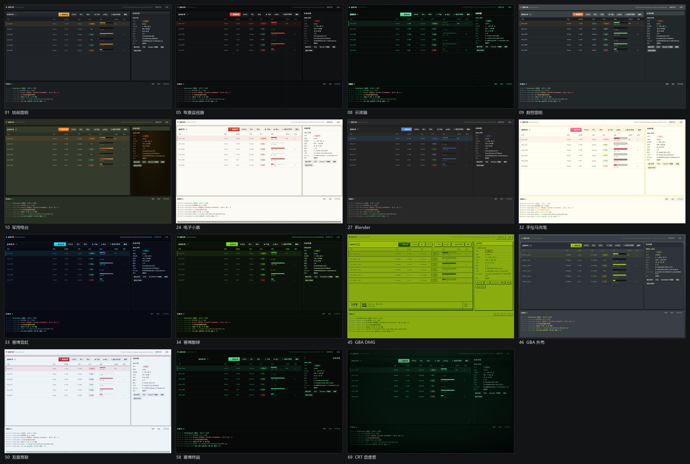

# 渲染守护 RenderGuard

Blender 批量渲染队列 + **崩溃自动续接**。单文件便携 exe，不需要安装 Python 或任何运行时（Windows 10/11 自带 WebView2）。

> **不想编译？** 直接下 [便携版 v1.0.0](https://github.com/raracannot/RenderGuard/releases/latest)：解压，双击 `RenderGuard.exe`。

---

## 它解决什么问题

挂着渲染过夜，Blender 半夜闪退 / 显卡驱动崩了 / 进程卡死，第二天回来发现只渲了 30 帧 —— 这是最浪费时间的一类事故。

RenderGuard 把渲染放到一个**独立的守护进程**里：

```
RenderGuard.exe  ──启动/监控/重启──▶  blender -b 工程.blend -a
       │                                      │
       │◀──── 心跳 + stdout ────────          │ 写帧
       ▼                                      ▼
   判定崩溃 / 卡死                       frames/frame_0001.png …
       │
       └── 重启并从缺失的帧继续 ────────────▶
```

关键点：**续接的判据是磁盘上已经存在的帧文件**，不是内存里的计数器。所以断电、重启机器、软件自己崩了，重新打开都能接着跑。

---

## 功能

- **批量队列**：多个任务排队，一个接一个跑，完成自动流转到下一个
- **批量建任务**：把一批 .blend 或整个文件夹拖进窗口，自动用默认参数解析成任务（也可点「文件夹」选目录）；解析过程有进度、可随时中断
- **从已打开的 Blender 直接取**：新建任务时会列出当前开着的 Blender 窗口，点一下文件名就自动填入完整路径并解析（连用的哪个 Blender 版本一起带上）
- **一键在 Blender 中编辑**：任务详情里点「Blender 中编辑」，用该任务指定的 Blender 打开它的工程，方便临时改东西
- **崩溃自动续接**：进程异常退出后自动重启，跳过已完成的帧（实测：8 帧任务在第 5 帧强杀，重启后补齐 8/8）
- **卡死检测**：长时间无输出 **且** CPU 时间不增长才判定卡死，避免 GPU 渲染时误杀
- **崩溃循环保护**：同一帧连续崩溃 N 次后隔离该帧、继续后面的帧，不会整夜卡在第 1 帧
- **参数覆盖**：读取 .blend 真实参数后，可逐项覆盖 —— 活动相机、分辨率、帧率、帧范围、动画/静帧、输出格式、输出路径
- **有效性测试**：一键启动选中的 Blender 并初始化 Python，确认它真的能跑（缺 DLL、装坏的 portable 版都能查出来）
- **输出文件校验**：按魔数校验 PNG/JPEG/EXR/TIFF 等，比"文件存在"可靠
- **纯净模式**：渲染时 `--factory-startup` 不加载任何插件，更稳更干净（自动保留 Cycles 的 GPU 设备偏好）
- **JSON 导入导出**：任务可导出成 JSON 存档、交给别的机器、或脚本生成
- **完成后自动关机**：队列全部结束时弹出 3 分钟倒计时，可取消或立即关机；用的是系统自身的定时器，软件关掉也照样执行
- **15 套皮肤**：设置 → 皮肤里点一下即可实时预览，保存后下次启动沿用。从 44 张设计稿里抽出来的皮肤化版本：配色、圆角、描边、字体、底纹、进度条形态都会跟着变（默认 09 数控面板）
- **实时控制台**：渲染进度、崩溃原因、重启记录都在界面里，也可打开完整日志文件

---

## 用法

1. 双击 `RenderGuard.exe`
2. **先设置默认 Blender**：点右上角「设置」→ 填 `blender.exe` 的完整路径（或点「浏览」）→ 保存
3. 点「添加任务」→ 选 .blend → 点「读取参数」
4. 勾选要覆盖的参数（不勾就用 .blend 原值）
5. 设置崩溃策略 → 「加入队列」
6. 点「开始」

每个任务也可以单独指定另一个 Blender 版本（多版本共存时很有用）；在任务弹窗里选好后点「设为默认」即可把它变成以后新建任务的默认值。

想整晚无人值守，把「崩溃后自动重启」和「续渲染」都勾上即可。

### 便携模式

exe 同级放一个 `portable.txt`，所有数据（队列、日志、WebView2 缓存）都写在 `exe目录\data\`，不碰系统目录。删掉这个文件则改用 `%LOCALAPPDATA%\RenderGuard`。

---

## 能力边界（重要）

| 场景 | 续接到哪一步 |
|---|---|
| 动画 → 图片序列（PNG/EXR/JPG…） | **帧级无损续接**，不丢任何已完成帧 |
| 动画 → 视频（mp4/FFmpeg） | 只能整段重来，界面会提示 |
| 单张大图静帧 | Cycles 不提供采样级断点，只能从这一帧重来 |

所以想受益于续接，**动画请输出图片序列**，最后再合成视频。

---

## 界面之外

无界面自检（用于验证安装 / 排障）：

```bat
RenderGuard.exe --selftest job.json
```

它会按 `job.json` 跑一个任务（含崩溃重试逻辑），结束后把结果写进配置里的 `resultPath`：

```json
{ "status": "Done", "done": 8, "total": 8, "restarts": 1, "failedFrames": [] }
```

`_test/e2e.py` 里有一个完整示例：起渲染 → 中途强杀 Blender → 断言自动重启并补齐所有帧。

> `--probe`（读取工程参数并输出 JSON）只在开发构建里可见，正式 exe 是窗口子系统，没有控制台输出。

---

## 从源码构建

需要 Rust（MSVC 工具链）。**不需要 Node.js**，前端是免构建的原生 HTML/CSS/JS。

```powershell
.\build.ps1
```

产物：`dist\RenderGuard.exe` + `dist\portable.txt`。

开发调试：

```powershell
cd src-tauri
cargo run
```

---

## 数据位置

| 内容 | 路径 |
|---|---|
| 队列与设置 | `data\state\jobs.json`、`settings.json` |
| 每个任务的完整日志 | `data\logs\<任务id>.log` |
| 崩溃转储（如有） | `data\logs\<任务id>-crash-*.txt` |
| 渲染参数快照 | `data\jobs\<任务id>.json` |

---

## 已知边界

- 只支持 Windows（用到了 Job Object 与 Win32 进程 API）
- 进程被外部强杀时，Job Object 会连带杀掉渲染中的 Blender，不会留下孤儿进程吃显卡
- 同一条队列同一时刻只跑一个任务（渲染本来就该独占 GPU）

## 皮肤

内置 15 套皮肤，设置 → 皮肤里点一下即时预览，保存后下次启动沿用（默认 09 数控面板）。
皮肤不只是换色：进度条形态、边框、底纹、字体、控制台质感都会跟着变。



## 构建

需要 Rust 工具链（MSVC）与 WebView2 运行时；**不需要 Node**，前端是免构建的原生 HTML/CSS/JS。

```powershell
powershell -ExecutionPolicy Bypass -File build.ps1
```

产物在 `dist\RenderGuard.exe`，免安装。同目录放一个空的 `portable.txt`，数据就写在 exe 旁边的 `data\`，否则写到 `%LOCALAPPDATA%\RenderGuard`。

## 许可

MIT，见 [LICENSE](LICENSE)。皮肤用的 Silkscreen 像素字体为 SIL OFL 1.1（见 `ui/fonts/OFL.txt`）。
